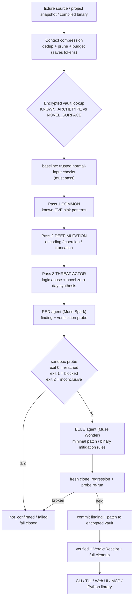

# Secure Mitigation System

Required Notice: Copyright (c) 2026 hackall360. All Rights Reserved for Commercial Use.
https://polyformproject.org/licenses/noncommercial/1.0.0


> An autonomous purple-team CI/CD pipeline that uses Meta Muse to write security patches, and air-gapped Docker to cryptographically prove they work.

**The executive hook:** every claim on this page is Docker output, not model opinion. A red-team agent proves a boundary is reachable (sandbox exit `0`), a blue-team agent writes a minimal patch, and trusted regression checks re-prove the boundary holds (exit `1`). Only all-green is `verified` — and every verdict ships a machine-readable `VerdictReceipt`.

## How it works (V1: 3-pass sweep, vault, binary, MCP)



Binary targets take the same loop through the trusted reversing harness (`file`/`strings`/`readelf` in-sandbox, `reject:` mitigation rules out). Surfaces: `--scan` / `--tui` / Web dashboard / `POST /mcp` / `python main.py --mcp` (STDIO) / `from modules.services.sms_api import scan_source`.
Technical deep dive: [`docs/ARCHITECTURE.md`](docs/ARCHITECTURE.md).

## Quick start

> [!WARNING]
> You need **Python 3.12+** and **Docker Engine/Desktop with Linux containers**.

```bash
python3 .jcode/tools/dev.py setup   # reproducible venv, hash-locked deps
source .venv/bin/activate

# No API key needed for these:
python main.py --list-targets
python main.py --init-images
python main.py --serve --port 8000
```

Open **http://127.0.0.1:8000**. To enable inference, copy `example.env` to
`.env`, add your key, and export it (`set -a; source .env; set +a`).
`.env` is git-ignored, owner-only (`0600`), and never auto-loaded.

## Demo in five minutes (`--ai-demo`)

```bash
python main.py --ai-demo --scan-profile extra_light --output-dir reports
python main.py --ai-demo --build-brief "tiny notes app" --vulns "CVE-2024-3094, SQL injection"
```

Muse *Greenhouse* generates a novel flawed service from live NVD intel, then
red breaks it in Docker and blue fixes it — no staged fixture, no canned
finding. More scans: `--scan`, `--project`, `--cve-scan`, `--tui`,
`--mcp-snippet` (external AI clients via `POST /mcp`), `--mcp` (MCP STDIO:
`sms_scan_source`, `sms_scan_binary`, `sms_query_vault_stats`,
`sms_verify_receipt`), `--sweep-passes 3`
(standard + deep + threat-actor), `--binary-target` (compiled ELF/Mach-O/PE
through the reversing harness, or `binary_argv_echo` for the bundled
fixture); full flag reference in
[`docs/reference/CLI.md`](docs/reference/CLI.md) and the production deep
dive in [`docs/ARCHITECTURE.md`](docs/ARCHITECTURE.md).

## 3-minute demo guide

**Part 1 — the Greenhouse showcase (90 seconds).** One command, no key, no
Docker: `python main.py --list-targets`, then open the dashboard and run the
bundled demo. Watch the pass indicator (`Pass 1 Common → Pass 2 Deep →
Pass 3 Threat-actor`), the vault badge (`Vault recall: Novel discovery →
committed to vault` on a second run of the same fixture), and the
compression badge (`Context compression: tokens saved X%`).

**Part 2 — your own target (90 seconds).** Scan a repo
(`python main.py --scan node_query_sink --sweep-passes 3`), sweep a binary
(`python main.py --binary-target binary_argv_echo`), or call the engine from
code (`from modules.services.sms_api import scan_source, verify_receipt`) or
any MCP client (`python main.py --mcp`, tools `sms_scan_source`,
`sms_scan_binary`, `sms_query_vault_stats`, `sms_verify_receipt`).

## Competitive differentiation

| Capability | SMS (this repo) | Typical LLM wrapper |
|---|---|---|
| Verdict authority | Air-gapped Docker exits `0`/`1`/`2` | Model opinion / lint score |
| Sweep depth | 3 passes incl. threat-actor zero-day synthesis | Single-shot finding |
| Binary targets | In-sandbox RE + harness mitigation rules | Source-only |
| Cross-session memory | AES-256-GCM vault (red/blue/green) | Stateless per run |
| Token efficiency | Compression middleware + vault priors on every report | Full context every call |
| Machine consumers | MCP server (HTTP + STDIO) + Python library | CLI stdout only |

## AI narrative: ~90% Muse-built

~90% of this codebase was developed dynamically utilizing Meta's Muse AI
models — agentic red/blue/research roles, the Docker proof loop, and the
dashboard were all iterated with Muse in the loop under human review, with
Docker exit codes (not model assertions) deciding every verdict.

## Why Muse?

We use the hosted Meta Developer models via API — **Muse Spark 1.3** for
high-speed boundary analysis (red team) and **Muse Wonder 1.0** for complex
patch generation (blue team) — because the split-agent architecture depends on
capabilities most frontier models will not combine:

- **Red-team willingness under developer-scoped safety.** Most frontier models
  refuse red-team work outright — they will not analyze an injection sink or
  author a boundary probe even in a sandboxed, defensive context. Muse trusts
  the developer to scope safety to the environment, and this system already
  owns the environment (disposable, `internal=True`, network-disabled,
  non-root containers; redacted artifacts).
- **Strict structured-schema discipline.** Every agent returns exactly one JSON
  object with ordered, nonempty fields — no markdown, no prose — validated by
  Pydantic before anything touches Docker.
- **Speed/cost split.** Spark runs analysis at roughly a fifth of Wonder's
  output-token cost, so the red/blue split is economical as well as effective.

Self-hosting open-weight models would trade our $150 credit pool for GPU
ops, weight serving, and weaker structured-output discipline — with no gain in
verdict quality, because verdicts come from Docker exits, not from bigger
models. Lighter provider guardrails mean *our* guardrails must be stronger —
isolation details in [`docs/ARCHITECTURE.md`](docs/ARCHITECTURE.md#isolation).

## Go deeper

- [`docs/ARCHITECTURE.md`](docs/ARCHITECTURE.md) — the production deep dive: evidence-gated loop, Wave 2 (SPEC 14.8) receipts/guards/mutations, Wave 5 (SPEC 14.9) freshness/frozen-pool/templates, isolation mechanics, config, project map.
- [`docs/index.md`](docs/index.md) — full doc map (guides, architecture, reference, decisions, research).
- [`docs/guides/DEVELOPMENT.md`](docs/guides/DEVELOPMENT.md) — environment, traps, browser matrix.
- [`TODO.md`](TODO.md) — the work queue. [`AGENTS.md`](AGENTS.md) — contributor contract.

## Acceptable use (short version)

Defensive research only: verify input boundaries in code you own or are
authorized to test. A `verified` result is finite Docker evidence, not proof of
security — review every candidate; never weaken the sandbox, guards, or
fail-closed semantics. Full terms: [below](#acceptable-use-warnings-and-disclaimer)
and [`docs/ARCHITECTURE.md`](docs/ARCHITECTURE.md#isolation).

## Acceptable Use, Warnings, and Disclaimer

This is a **defensive cybersecurity research project**: verify that a specific input boundary is enforced and propose a minimal sanitization that preserves normal behavior — nothing more.

**Intended use only:**

- Verifying input-handling boundaries in code you own or are authorized to test.
- Studying red/blue remediation workflows in isolated, disposable sandboxes.
- Evaluating AI-assisted patch review under evidence-gated, human-supervised conditions.

**Not intended, not permitted:**

- This system is **not a pure red-team tool** — not built, licensed, or supported for discovering or exploiting vulnerabilities in systems you do not own or lack explicit authorization to test.
- This system is **not a pure blue-team shield** — a `verified` result is finite evidence from a fixed set of probes, not proof of security, correctness, or behavioral equivalence.
- **No guarantee of safety or security is provided.** Sandboxes can be escaped, verifiers can be wrong, patches can introduce new faults, and model output can be mistaken.
- **Do not repurpose this software for misuse** — adapting any part of it to attack, intrude upon, surveil, or degrade systems without authorization is prohibited.
- **Do not remove or weaken the safety controls.** Sandbox restrictions, patch guards, artifact redaction, permission controls, and fail-closed semantics are load-bearing.

**Provided as is**, without warranty of any kind. Operating this system — including any outbound network activity from research sidecars or local scanners — is at your own risk and under your own authority. Comply with all applicable laws; if you are unsure whether a use is authorized, do not proceed. **Human supervision is required:** every candidate patch must be reviewed by a qualified person before application, and automated outputs must never trigger unattended changes to production systems.

Licensed under [PolyForm Noncommercial 1.0.0](LICENSE.md).
