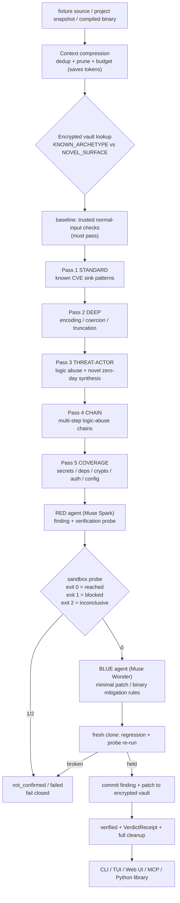
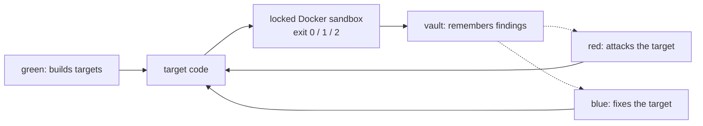

# Secure Mitigation System

Required Notice: Copyright (c) 2026 hackall360. All Rights Reserved for Commercial Use.
https://polyformproject.org/licenses/noncommercial/1.0.0


> An autonomous purple-team CI/CD pipeline that uses Meta Muse to write security patches, and air-gapped Docker to cryptographically prove they work.

A tool that finds a weak spot in code, fixes it, and proves the fix works. This page takes about 3 minutes to read.

## What it is

The tool runs a loop with two AI agents and a locked box.

1. A **red team** agent reads the code and finds a weak spot.
2. Red writes a small test (a "probe") that tries to reach that weak spot.
3. A **sandbox** runs the probe. The sandbox is a Docker container with no network.
   Exit 0 means the weak spot was reached. Exit 1 means it was blocked. Exit 2 means unclear.
4. A **blue team** agent writes a small patch to fix the weak spot.
5. Normal-input checks run, then the probe runs again on the patched code.
6. Only if the probe now fails (exit 1) and the normal checks still pass, the result is marked **verified**.

Containers and networks are removed when the run ends.

## Quick start

You need Python 3.12+, Docker, and a Meta Muse API key.

```bash
python -m venv .venv
.venv/bin/python scripts/dev/dev.py setup   # install dependencies
cp example.env .env                          # then put your key in META_MUSE_API_KEY
.venv/bin/python main.py --init-images       # build the sandbox images
.venv/bin/python main.py --serve             # dashboard at http://localhost:8000/web/
```

Other useful commands:

```bash
.venv/bin/python main.py --help              # all options
.venv/bin/python main.py --list-targets      # bundled practice targets
.venv/bin/python scripts/dev/dev.py check    # run the test gate
```

## Fast demo

```bash
.venv/bin/python demo_run.py
```

No arguments. It pulls the public practice app `BrenesRM/insecure-web` at commit `5d1b791` and runs the full loop.

One measured run:

- Found: SQL injection in `POST /login`.
- Probe exit 0 before the patch, exit 1 after the patch.
- Status: `verified`.
- Time: 4:16. Cost: $0.0070.
- The wrapper prints a labelled heartbeat every 5 seconds. The longest gap with no output was 6 seconds.

Be honest with yourself about this demo. The AI is not deterministic. In 4 runs on the same day, 2 were verified, 1 was inconclusive before the patch, and 1 was inconclusive after the patch.

The demo also has limits. The sandbox is offline and has no Flask. So the normal-input check is only a parse check (`ast.parse`) of `app/app.py`. The probe tests the query code directly with `sqlite3`, not over HTTP. The demo passes a `--contract` note that tells red these sandbox facts.

## Scan any repo (Universal Omni-Ingest)

```bash
.venv/bin/python main.py --ingest-repo https://github.com/OWNER/REPO --commit-hash SHA --allow-remote-inference
```

- The repo is cloned inside an offline Docker staging step, pinned to the commit you give.
- The tool guesses how to run the app (Node, PHP, Python, and so on). This is `detect_runtime` in `library/services/repo_intake.py`.
- If the guess is wrong, set it yourself with `--command "..."` (and `--test-command "..."` for the normal checks).
- Use `--ingest-dry-run` to see the plan without running a scan.

## Models: Meta Muse Spark

The tool uses Meta Muse models only. Defaults (from `library/core/config.py` and `example.env`):

- Red model: `muse-spark-1.3-contributor` (`META_MUSE_RED_MODEL`)
- Blue model: `muse-spark-1.3-contributor` (`META_MUSE_BLUE_MODEL`)
- Open-weight option: `meta-models/muse-spark-open-1026`
- Optional escalation: set `META_MUSE_BLUE_ESCALATION_MODEL` (for example `muse-wonder-1.0`). If blue fails, it gets exactly one retry with that model. Empty means off.

The `balanced` profile (`--profile balanced`) uses Spark for red and Spark for blue.

**How does Muse compare to Opus 5.5, Fable 5.1, or Luna 6?** We do not know. No head-to-head benchmark was run. We use Muse Spark because it is cheap and it worked on our tests: the demo above cost under one cent per verified run.

## Scale: big repos (AnyCam)

What exists today:

- Triage ranks files and scans them in order, most likely first.
- Red gathers evidence in parallel (`red_evidence_parallelism`, default 4, env `PURPLEBOX_RED_EVIDENCE_PARALLELISM`).

Our first AnyCam run had no early exit. It was stopped by hand at 16:06. It cost $0.37. The result was partial.

New, opt-in: red early exit. Set `PURPLEBOX_RED_EARLY_EXIT_HIGH=N`. After N high-confidence candidates, evidence batches that have not started are skipped, and the coverage notes say so. Batches already running still finish. It is off by default.

```bash
.venv/bin/python scale_run.py   # AnyCam scale run
```

Early exit has not yet been measured live on AnyCam. Large repos are not a solved case yet.

## Limitations

- `verified` means one probe was blocked after the patch. It does not mean the code is safe.
- Results vary run to run. Re-run before you trust a result.
- The sandbox has no network. Apps that need outside services or missing packages may only get weak checks (like a parse check).
- Runtime detection can guess wrong. Use `--command` when it does.
- Early exit on big repos is opt-in and not yet measured live, so cost and time grow with repo size.
- No benchmark against other model families.
- A person must review every patch.

## More reading

- [`docs/DEMO.md`](docs/DEMO.md): how to record the demo.
- [`docs/HOW_IT_WORKS.md`](docs/HOW_IT_WORKS.md): how the parts fit together.
- [`docs/TRAPS.md`](docs/TRAPS.md): things that looked right and were not.
- [`docs/index.md`](docs/index.md): map of all docs.

## Tests

```bash
.venv/bin/python scripts/dev/dev.py check
```

Last result: 1697+ passed, 3 skipped. Tests are mocked. They make no API calls.

## Reference (full detail)

The sections below are the full technical detail.

### How the loop works

A bare `--scan` runs a single finding loop: context compression, vault
recall, baseline, one red/blue cycle, regression + re-probe, receipt.
Nothing in that loop is skipped. The multi-pass ladder in the diagram
(Pass 1–5) runs only with `--sweep-passes N`, where N=1..5 selects a
prefix of `SWEEP_PASSES`: 1=standard (common CVE sink patterns),
2=+deep (encoding/coercion/truncation), 3=+threat-actor (logic abuse +
novel synthesis), 4=+chain (multi-step logic-abuse chains),
5=+coverage (hardcoded secrets, vulnerable dependencies, weak crypto,
missing authz, dangerous config).



Binary targets use the same loop (`file` / `strings` / `readelf` in-sandbox, `reject:` rules out). Chain fixtures with two linked steps work too.

### The team

Four parts act as one crew. Red attacks. Blue fixes. Green builds fresh targets. The vault remembers.



Each `verified` result ships a `VerdictReceipt` (`library/workflows/workflow.py:237`):
fields `pre_exit_code` / `post_exit_code` / `regression_passed` bind the fix
SHA-256 to the exact Docker exits behind the claim. Verify one with
`sms_verify_receipt`; the receipt re-attests the same patch only.

### Try it

You need **Python 3.12+**, **Node.js** (syntax checks + Node fixtures), and **Docker** (Linux containers). One command goes from clone to live verdict:

```bash
git clone https://github.com/hackall360/Secure-Mitigation-System.git
cd Secure-Mitigation-System
python3 scripts/dev/dev.py quickstart            # .venv via uv (stdlib fallback), images, chain proof: no key
python3 scripts/dev/dev.py quickstart --keyed    # same, plus one live chain scan with your .env key
```

Keyless default runs the offline harness (no key, no Muse calls). Real output
(`python scripts/dev/dev.py offline_scan`, 2026-11-03):

```text
node_query_sink: status=verified pre=0 post=1 baseline=True regression=True cleanup=True events=19
node_chain_link: status=verified pre=0 post=1 baseline=True regression=True cleanup=True events=19
php_command_sink: status=verified pre=0 post=1 baseline=True regression=True cleanup=True events=19
mysql_insecure_conf: status=verified pre=0 post=1 baseline=True regression=True cleanup=True events=19
```

`pre=0` = probe reached the boundary. `post=1` = after the patch it held.
`verified` prints only when both plus regression hold on a fresh clone.
`--keyed` reads the key from the owner-only `.env` first and fails closed without it, then runs one live `node_chain_link` scan. Add CI/CD adoption: the same command runs in a pipeline: gate on exit 0, archive the receipt line as the build artifact.

Manual path (same stages, step by step):

```bash
python3 scripts/dev/dev.py setup
source .venv/bin/activate
python main.py --list-targets
python main.py --init-images
python main.py --serve --port 8000
```

Open **http://127.0.0.1:8000**. For AI features, copy `example.env` to `.env` and add your key. `.env` stays local.

Use it from code:

```python
from library.services.sms_api import scan_source, verify_receipt
```

(`modules.*` import paths still work via a shim.)

### Demo in five minutes (`--ai-demo`)

```bash
python main.py --ai-demo --scan-profile extra_light --output-dir reports
python main.py --ai-demo --build-brief "tiny notes app" --vulns "CVE-2024-3094, SQL injection"
```

Green builds a new flawed service from live intel. Red breaks it in Docker. Blue fixes it. Other ways in: `--scan`, `--project`, `--cve-scan`, `--tui`, `--mcp-snippet`, `--mcp` (tools `submit_code_snippet`, `sms_scan_source`, `sms_scan_binary`, `sms_scan_repo`, `sms_query_vault_stats`, `sms_list_vault_namespaces`, `sms_replay_vault_record`, `sms_verify_receipt`, `sms_scan_status`, `sms_ops_status`, `sms_showcase_status`), `--sweep-passes 3` (first three passes: standard, deep, threat-actor; use 4 to add the chain pass, 5 for the coverage pass), `--binary-target binary_argv_echo`. Full flags: [`docs/reference/CLI.md`](docs/reference/CLI.md).

### 3-minute demo guide

**The dashboard (30 seconds).** Open `web/index.html` (Start), pick a Demo (`web/demo-setup.html`) or Production (`web/prod-setup.html`) setup, then Launch into `demo.html` or `console.html`. The console shows a live radial system map with team-colored agents (red offense, blue defense, green build, purple verified), the `stagebar` phase strip, and comms/activity logs streaming in real time. The header scoreboard totals session messages, findings, patches, and verified runs; run options (sweep depth, profile, research, binary) come from the setup schema. Panel map: [`docs/reference/DASHBOARD.md`](docs/reference/DASHBOARD.md).

**The showcase (90 seconds).** Run `python main.py --list-targets`, then run the bundled demo. Watch the pass steps (Standard, Deep, Threat-actor, Chain), the Vault recall badge on a repeat run, and the Context compression badge.

**Your own target (90 seconds).** Scan a repo, sweep `binary_argv_echo`, or call `sms_scan_source` and check it with `sms_verify_receipt`. Any repo in any language: the PreScanObserver detects the ecosystem (Python, Node, PHP, C, C++, Rust, Go, Make) and maps it to a build command: no language is refused. The thick polyglot image carries gcc/make/cmake/go/rustc/cargo, and compiled snippets (`--snippet-language c|rust|go`) compile-and-run inside the sandbox.

### Why this design

The loop needs a model that will probe its own code in a locked sandbox. Many hosted models refuse that step, even for defense. So point-and-fix tools stay common: they flag a line and stop.

Supply-chain attacks show the cost. Shai-Hulud and php2shell, plus steady npm and PyPI waves, slip bad code into clean projects. Normal antivirus misses new shapes because it matches old ones. Only a live test, apart from your machine, shows a fix holds.

### Competitive differentiation

| | This repo | Typical wrapper |
|---|---|---|
| Verdict | Docker exits `0` / `1` / `2` | Model opinion |
| Depth | 3 passes, incl. threat-actor pass | One shot |
| Binaries | In-sandbox review + rules | Source only |
| Memory | Shared encrypted vault | None |
| Cost | Vault recall + Context compression cut tokens | Full context each call |
| Access | MCP + Python library | CLI text only |

### AI narrative: ~90% Muse-built

~90% of this code was written with Meta Muse models: red, blue, and green agents plus the Docker loop and dashboard, all under human review. Docker exits decide each verdict, not model claims.

### Meta Hackathon: what was built here (Oct 27 – Nov 4)

Everything below was built during the hackathon window on the 0.x line (current `0.14.0`).
Prior work is the fixture/loop skeleton; the hackathon turned it into a product.

- **Red/blue/green agent loop on Meta models.** Red default `muse-spark-1.3-contributor`
  (fast triage), blue default `muse-spark-1.3-contributor` (fast patch, with a keyed
  Wonder escalation in reserve); per-token pricing and the
  economy/balanced/quality profiles live in `library/core/pricing.py` and
  `library/core/profiles.py`. Greenhouse (`library/services/demo_gen.py`) is a third
  Muse role: it authors novel vulnerable demo services from live threat-intel summaries,
  so `--ai-demo` exercises the loop on targets no human wrote.
- **Evidence-gated verification.** Docker exit codes (`0` reached / `1` held /
  `2` inconclusive) plus trusted normal-input regression decide every `verified` claim;
  `VerdictReceipt` binds the fix SHA-256 to the exact exits. Four sweep passes
  (standard, deep, threat-actor, chain) plus a binary-review path and a CVE reachability
  triage share the same gate. Nothing ships on model opinion.
- **Tri-surface product.** CLI (`main.py`), TUI (`tui.py`), Web UI (`web/` cinematic
  presenter + console + setup/demo switches), MCP bridge, and Python library stay in
  sync; headless Firefox/Chrome E2E plus 1000+ RED-first tests guard every surface.
  Dev/prod observability (`logs/<signal>/<aspect>.jsonl`, dev ~10x detail) is stdlib-only.
- **Showcase rig.** `video-demo/` holds a local ChatTTS narration booth, a clean-room
  PipeWire capture node + gamescope sandbox + isolated-audio scripts, and a
  DawDreamer/Faust DSP score factory: built during the hackathon as dev tooling for
  the 3-minute demo (see `docs/DEMO_SCRIPT.md` for the timed beat sheet).
- **Agentic autonomy.** Vault recall replays prior patches onto renamed schemas for
  cents; the 5-pass sweep and chain synthesis run without human step-through; fail-closed
  contracts (honest refusals, JSON-stdout purity, per-session Docker cleanup) hold under
  fault. Human review gates every merge: the ship path is always:

```bash
git checkout -b feature/<short-description>   # never main/develop
# ... edits + dev.py check green ...
git checkout develop && git merge --no-ff feature/<short-description>
git push origin develop
git checkout main && git merge --no-ff develop
git push origin main
git checkout develop
```

### Why Muse?

We use hosted Meta models: **Muse Spark 1.3** for fast red checks and default blue patches, with **Muse Wonder 1.0** in reserve as a keyed one-shot escalation after a rollback. Real per-1M prices from `library/core/pricing.py`:

```text
muse-spark-1.3-contributor: input 0.10 / output 0.20 USD per 1M tokens
muse-wonder-1.0:            input 4.00 / output 20.00 USD per 1M tokens
```

Both roles run the cheap tier by default: the Wonder split is ~40x on input, so Wonder stays a keyed escalation, not the default.
Our tests ran on the hackathon's small credit pool. Docker scores each verdict, so bigger models would add cost, not quality.

The loop needs a model that will attack its own code inside a locked sandbox and then patch it. Muse Spark and Wonder both do that here. Some hosted models are built to refuse the attack step even for defense: the contest brief names Opus 5.5, Fable 5.1, Luna 6, and Sol 6.1 as models that decline offensive probing: so tools built on refusers stay point-and-fix: they flag a line and stop.

### Observability

Dev/prod observability: per-aspect JSONL logs, metrics, and traces under `logs/<signal>/<aspect>.jsonl`
(signals `logs`/`metrics`/`traces`; aspects like `workflows.fixture`, `intel.research`,
`services.api`). `prod` records milestones; `dev` records ~10x detail records on the same run.
Mode from `--observability-mode` or `PURPLEBOX_OBSERVABILITY_MODE` (default `prod`). Full guide:
[`docs/guides/OBSERVABILITY.md`](docs/guides/OBSERVABILITY.md).

### Go deeper

- [`docs/HOW_IT_WORKS.md`](docs/HOW_IT_WORKS.md): start here: the loop in plain words.
- [`docs/TECHNICAL_BREAKDOWN.md`](docs/TECHNICAL_BREAKDOWN.md): deep cut: passes, vault, isolation, 429s, receipts, telemetry, with file and line pointers.
- [`docs/ARCHITECTURE.md`](docs/ARCHITECTURE.md): full detail: receipts, guards, isolation, config.
- [`docs/index.md`](docs/index.md): map of all docs. [`TODO.md`](TODO.md): work queue.

## Acceptable Use, Warnings, and Disclaimer

Defensive work only: check input rules in code you own or may test, in throwaway sandboxes, with a person watching.

Do not use this on systems you may not test. Do not treat `verified` as proof of safety. Sandboxes can fail and models can be wrong. Do not strip safety controls to harm others. You carry the risk and must follow the law. When in doubt, stop.

Licensed under [PolyForm Noncommercial 1.0.0](LICENSE.md).
