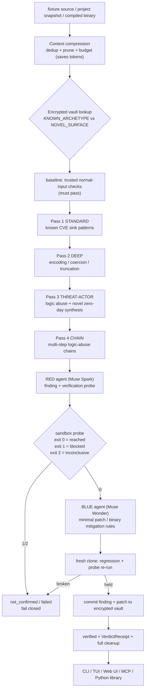
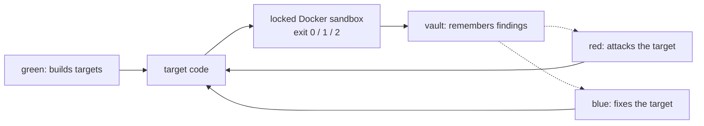

# Secure Mitigation System

Required Notice: Copyright (c) 2026 hackall360. All Rights Reserved for Commercial Use.
https://polyformproject.org/licenses/noncommercial/1.0.0


> An autonomous purple-team CI/CD pipeline that uses Meta Muse to write security patches, and air-gapped Docker to cryptographically prove they work.

## What it is

This tool finds weak spots in code and proves the fixes work. It does not ask you to trust the AI. It runs real tests in isolation and shows the results.

Think of it as a locked room. A test goes in and tries to break a rule, like passing bad input to a command. The room has no network and is wiped after. Exit `0` means the rule broke. Exit `1` means it held. Exit `2` means the test itself was bad. Only `0` then `1` after a fix counts as `verified`.

New here? Start with the plain guide: [`docs/HOW_IT_WORKS.md`](docs/HOW_IT_WORKS.md). For full detail, see [`docs/ARCHITECTURE.md`](docs/ARCHITECTURE.md).

## How the loop works

A bare `--scan` runs a single finding loop: context compression, vault
recall, baseline, one red/blue cycle, regression + re-probe, receipt.
Nothing in that loop is skipped. The multi-pass ladder in the diagram
(Pass 1–4) runs only with `--sweep-passes N`, where N=1..4 selects a
prefix of `SWEEP_PASSES`: 1=standard (common CVE sink patterns),
2=+deep (encoding/coercion/truncation), 3=+threat-actor (logic abuse +
novel synthesis), 4=+chain (multi-step logic-abuse chains).



Binary targets use the same loop (`file` / `strings` / `readelf` in-sandbox, `reject:` rules out). Chain fixtures with two linked steps work too.

## The team

Four parts act as one crew. Red attacks. Blue fixes. Green builds fresh targets. The vault remembers.



Each `verified` result ships a `VerdictReceipt`: the fix hash plus the exact exit codes behind the claim.

## Try it

You need **Python 3.12+** and **Docker** (Linux containers). One command goes from clone to live verdict:

```bash
git clone https://github.com/hackall360/Secure-Mitigation-System.git
cd Secure-Mitigation-System
python3 .jcode/tools/dev.py quickstart            # .venv via uv (stdlib fallback), images, chain proof — no key
python3 .jcode/tools/dev.py quickstart --keyed    # same, plus one live chain scan with your .env key
```

Keyless default runs the offline harness (no key, no Muse calls) and prints the verdict + receipt per fixture. `--keyed` reads the key from the owner-only `.env` first and fails closed without it, then runs one live `node_chain_link` scan. Add CI/CD adoption: the same command runs in a pipeline — gate on exit 0, archive the receipt line as the build artifact.

Manual path (same stages, step by step):

```bash
python3 .jcode/tools/dev.py setup
source .venv/bin/activate
python main.py --list-targets
python main.py --init-images
python main.py --serve --port 8000
```

Open **http://127.0.0.1:8000**. For AI features, copy `example.env` to `.env` and add your key. `.env` stays local.

Use it from code:

```python
from library.services.sms_api import scan_source, verify_receipt
```

(`modules.*` import paths still work via a shim.)

## Demo in five minutes (`--ai-demo`)

```bash
python main.py --ai-demo --scan-profile extra_light --output-dir reports
python main.py --ai-demo --build-brief "tiny notes app" --vulns "CVE-2024-3094, SQL injection"
```

Green builds a new flawed service from live intel. Red breaks it in Docker. Blue fixes it. Other ways in: `--scan`, `--project`, `--cve-scan`, `--tui`, `--mcp-snippet`, `--mcp` (tools `submit_code_snippet`, `sms_scan_source`, `sms_scan_binary`, `sms_query_vault_stats`, `sms_verify_receipt`, `sms_scan_status`), `--sweep-passes 3` (first three passes: standard, deep, threat-actor; use 4 to add the chain pass), `--binary-target binary_argv_echo`. Full flags: [`docs/reference/CLI.md`](docs/reference/CLI.md).

## 3-minute demo guide

**The dashboard (30 seconds).** Open `web/index.html` (Start), pick a Demo (`web/demo-setup.html`) or Production (`web/prod-setup.html`) setup, then Launch into `demo.html` or `console.html`. The console shows a live radial system map with team-colored agents (red offense, blue defense, green build, purple verified), the `stagebar` phase strip, and comms/activity logs streaming in real time. The header scoreboard totals session messages, findings, patches, and verified runs; run options (sweep depth, profile, research, binary) come from the setup schema. Panel map: [`docs/reference/DASHBOARD.md`](docs/reference/DASHBOARD.md).

**The showcase (90 seconds).** Run `python main.py --list-targets`, then run the bundled demo. Watch the pass steps (Standard, Deep, Threat-actor, Chain), the Vault recall badge on a repeat run, and the Context compression badge.

**Your own target (90 seconds).** Scan a repo, sweep `binary_argv_echo`, or call `sms_scan_source` and check it with `sms_verify_receipt`.

## Why this design

The loop needs a model that will probe its own code in a locked sandbox. Many hosted models refuse that step, even for defense. So point-and-fix tools stay common: they flag a line and stop.

Supply-chain attacks show the cost. Shai-Hulud and php2shell, plus steady npm and PyPI waves, slip bad code into clean projects. Normal antivirus misses new shapes because it matches old ones. Only a live test, apart from your machine, shows a fix holds.

## Competitive differentiation

| | This repo | Typical wrapper |
|---|---|---|
| Verdict | Docker exits `0` / `1` / `2` | Model opinion |
| Depth | 3 passes, incl. threat-actor pass | One shot |
| Binaries | In-sandbox review + rules | Source only |
| Memory | Shared encrypted vault | None |
| Cost | Vault recall + Context compression cut tokens | Full context each call |
| Access | MCP + Python library | CLI text only |

## AI narrative: ~90% Muse-built

~90% of this code was written with Meta Muse models: red, blue, and green agents plus the Docker loop and dashboard, all under human review. Docker exits decide each verdict, not model claims.

## Why Muse?

We use hosted Meta models: **Muse Spark 1.3** for fast red checks and **Muse Wonder 1.0** for hard blue patches. Per-token prices live in `library/core/pricing.py`: Spark runs about a third of Wonder on input and a fifth on output, so the split saves money. Our tests ran on the hackathon's small credit pool. Docker scores each verdict, so bigger models would add cost, not quality.

The loop needs a model that will attack its own code inside a locked sandbox and then patch it. Muse Spark and Wonder both do that here. Some hosted models are built to refuse the attack step even for defense — the contest brief names Opus 5.5, Fable 5.1, Luna 6, and Sol 6.1 as models that decline offensive probing — so tools built on refusers stay point-and-fix: they flag a line and stop.

## Observability

Dev/prod observability: per-aspect JSONL logs, metrics, and traces under `logs/<signal>/<aspect>.jsonl`
(signals `logs`/`metrics`/`traces`; aspects like `workflows.fixture`, `intel.research`,
`services.api`). `prod` records milestones; `dev` records ~10x detail records on the same run.
Mode from `--observability-mode` or `PURPLEBOX_OBSERVABILITY_MODE` (default `prod`). Full guide:
[`docs/guides/OBSERVABILITY.md`](docs/guides/OBSERVABILITY.md).

## Go deeper

- [`docs/HOW_IT_WORKS.md`](docs/HOW_IT_WORKS.md) — start here: the loop in plain words.
- [`docs/TECHNICAL_BREAKDOWN.md`](docs/TECHNICAL_BREAKDOWN.md) — deep cut: passes, vault, isolation, 429s, receipts, telemetry, with file and line pointers.
- [`docs/ARCHITECTURE.md`](docs/ARCHITECTURE.md) — full detail: receipts, guards, isolation, config.
- [`docs/index.md`](docs/index.md) — map of all docs. [`TODO.md`](TODO.md) — work queue.

## Acceptable use (short version)

Test only code you own or may test. A `verified` mark is test output, not proof of safety. Keep the guards on. A person must review each patch. Full terms below and in [`docs/ARCHITECTURE.md`](docs/ARCHITECTURE.md#isolation).

## Acceptable Use, Warnings, and Disclaimer

Defensive work only: check input rules in code you own or may test, in throwaway sandboxes, with a person watching.

Do not use this on systems you may not test. Do not treat `verified` as proof of safety. Sandboxes can fail and models can be wrong. Do not strip safety controls to harm others. You carry the risk and must follow the law. When in doubt, stop.

Licensed under [PolyForm Noncommercial 1.0.0](LICENSE.md).
