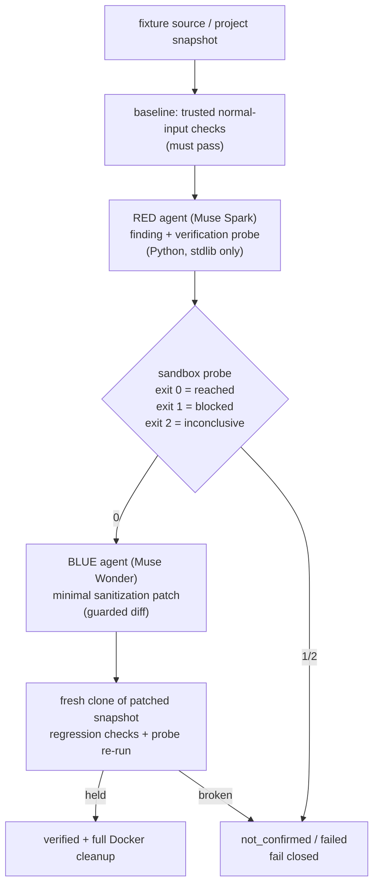

# Secure Mitigation System

Required Notice: Copyright (c) 2026 hackall360. All Rights Reserved for Commercial Use.
https://polyformproject.org/licenses/noncommercial/1.0.0


> **Executive summary.** Secure Mitigation System is a red/blue input-boundary verification harness for code you own: a red-team Muse agent finds an input-handling weakness and proves it with a container exit code, a blue-team Muse agent writes a minimal sanitization patch, and trusted regression checks confirm the boundary holds. It exists for developers and security reviewers who need **evidence, not opinion** — every claim about a boundary is Docker output, and every container is removed afterward.

## Key Features

- **Evidence-gated verdicts.** Probes run in air-gapped Docker; exit `0` = boundary reached, `1` = blocked, `2` = inconclusive (fails closed). The model proposes; Docker disposes.
- **Minimal, reviewable patches.** Conservative patch guards — small-diff budget, protected-line preservation, exact MySQL allowlists — keep every candidate auditable.
- **Three bundled fixtures.** `node_query_sink` (dynamic-expression sink), `php_command_sink` (local command argument), `mysql_insecure_conf` (config audit, no DB server started).
- **Scan your own repo.** `--project` snapshots any local checkout (read-only, never mounted) through evidence-gated red/blue cycles, up to 20 cycles.
- **AI-built demos.** `--ai-demo` has Muse *Greenhouse* generate a novel flawed service from live NVD intel, then red/blue exercise it end to end.
- **Research-grounded, optionally.** Opt-in red/blue research sidecars over keyless OSV / CIRCL / GHSA / EPSS plus five local scanners (Trivy, Grype, OSV-Scanner, Dependency-Check, Dependency-Track).
- **Three surfaces, one workflow.** Dashboard (FastAPI + WebSocket), terminal UI (`--tui`), and CLI (`--scan` / `--project` / `--ai-demo` / `--cve-scan`) share the same async pipeline.
- **Safe by construction.** Non-root users, dropped capabilities, CPU/RAM/PID caps, read-only roots, redacted owner-only artifacts, no secrets in Docker, reports, or UI.
- **Live-tested.** `dev.py check` gate (lint, format, mocked unit tests, fixture checks) plus live Docker, real-Muse, and headless-browser (Chrome/Firefox) proofs.

### Wave 2 (0.3.0, pending ship)

- **Reachability-ranked CVE output.** CVE scans attach `reach_score` (deterministic 0-100) plus `reach_evidence`, fusing OSV fixed-version ranges with static sink adjacency — keyless, no inference.
- **CVE disclosure fast lane.** `--fast-lane` runs static + OSV only, in deterministic order, with no Muse or NVD calls.
- **Tunable AI demos.** Greenhouse takes `--demo-size small|standard`, `--flaw-count 1..8`, and `--demo-seed`; the dashboard exposes the same as Demo size / Flaw count / Demo seed controls.
- **Ghost-probe liveness for inconclusive probes.** The post-probe liveness check against the still-running target now covers inconclusive (`exit 2`) probes as well as blocked (`exit 1`) ones, so a crashed service cannot earn success.

### Wave 5: trust signals (shipped)

- **GHSA CVE-id lookup fix.** `ghsa_lookup_by_cve` queries `?cve_id=` (the old path sent CVE ids as `?package=`, silently degrading results); records now consume embedded `epss`, `cvss_severities` (v4 preferred), and `first_patched_version`. Never-raises preserved.
- **KEV as fifth signal.** CISA KEV keyless JSON joins `cve_records` (exploited flag + due date); KEV/EPSS-percentile likelihood is tie-breaking evidence in `reachability_score` and never lowers the fail-closed sink/fixed-version floor.
- **Differential normal-contract gate.** After patch + probe-block, trusted normal-input checks re-run against original and patched targets; equal pass/fail class required, recorded as explicit `CycleEvidence.differential_passed`, mismatch = not verified.
- **Fast-lane tiering.** Output orders by actionability `(-reach_score, fix availability, id)` instead of id-sort alone. Gate: `dev.py check` 367 passed.

### Wave 7-8: live signals + property contracts (shipped)

- **KEV/EPSS via the real producer path.** `kev_listed`/`epss_percentile` are now wired through `cve_workflow` enrichment into `reachability_score` (previously Wave 5 tests stubbed the summary dict, so the dead `summarize_osv_vuln` path was invisible). Tie-break only; never lowers the fail-closed sink/fixed-version floor.
- **Per-process KEV catalog cache.** `research.kev_lookup` fetches the CISA catalog once per process instead of per CVE id; fail-first cache test in `tests/test_scanners.py`.
- **Property/metamorphic normal-contract checks.** Seeded deterministic scripts (`checks.project_property_script`, seed `20261029`) run after regression green and veto a retain on any non-zero exit (`property_gate_passed`); exceptions resolve to exit 2, fail-closed. Opt-in by contract first line naming the check id; anything else skips, so arbitrary projects are unaffected.
- **Split scripts by real response shape.** `node_query_sink` asserts the JSON envelope; `project_lookup_text` asserts the plain-text contract (exact names for known ids, empty 200 body for seeded random ids); PHP hosts assert byte-stability under repetition; config keys assert idempotent re-read.
- **LOW bundle.** Research fetch caps, EPSS sanitizer reuse, `intel_search` CVE shape. Gate: `dev.py check` 392 passed; live `project_scan` 2/2 retained with properties exit 0.

## Architecture / How It Works



Each cycle separates **red discovery and proof → blue sanitization proposal → red re-verification → blue final report**. Repeated cycles carry forward verified candidate changes inside the sandbox, never into your source tree. Only `verified` means the probe reached the sink before the patch, normal behavior held throughout, and the probe is blocked after. Original fixture files are never overwritten.

> **Why Muse is load-bearing, not branding:** most frontier models refuse red-team work outright — they will not analyze an injection sink or author a boundary probe even in a sandboxed, defensive context. Muse trusts the developer to scope safety to the environment, and this system already owns the environment (disposable, network-disabled, non-root containers; redacted artifacts). Spark runs analysis at roughly a fifth of Wonder's output-token cost, so the red/blue split is economical as well as effective. Lighter provider guardrails mean *our* guardrails must be stronger — see [Isolation](#isolation) below.

## Quick Start

> [!WARNING]
> You need **Python 3.12+** and **Docker Engine/Desktop with Linux containers**. Image initialization downloads Alpine packages; scan containers never install dependencies or publish host ports.

```bash
python3 .jcode/tools/dev.py setup   # reproducible venv, hash-locked deps
source .venv/bin/activate           # Windows: .venv\Scripts\Activate.ps1

# No API key needed for these:
python main.py --list-targets
python main.py --init-images
python main.py --serve --port 8000
```

Open **http://127.0.0.1:8000**. The dashboard loads without Docker or a key and explains missing setup. Stop the server before changing its environment.

To enable inference, copy `example.env` to `.env`, add your key, and export it:

```bash
cp example.env .env   # edit: META_MUSE_API_KEY=...
set -a; source .env; set +a
python main.py --serve --port 8000
```

> [!NOTE]
> `.env` is ignored by Git, created owner-only (`0600`), and **never loaded automatically**. No keys are sent to Docker, written to reports, returned by health checks, or displayed in the UI. A real scan sends the selected source to the configured Muse endpoint.

## Usage

All commands run from the repo root (`python main.py ...`). Bare `python main.py` serves the dashboard, same as `--serve`.

<details>
<summary><strong>Scan a bundled fixture</strong></summary>

```bash
python main.py --scan node_query_sink --output-dir reports
python main.py --scan php_command_sink --profile economy
python main.py --scan node_query_sink --research --research-scanners trivy,grype
```

`--profile` picks a model profile (`economy` / `balanced` / `quality` / `custom`). `--research` enables the sidecars (extra model calls, host network only — Docker evidence still decides). CLI exit status is `0` for a verified candidate with successful cleanup, `1` for all other outcomes, `130` for interruption. `--output-dir` creates a fresh run folder with `report.json` and, when available, `candidate.patch`.
</details>

<details>
<summary><strong>Scan your own repository</strong></summary>

Use an existing local checkout. The harness deliberately does not clone URLs, execute Git hooks, run repository Dockerfiles, or download dependencies. Prepare a trusted runtime image beforehand; commands are JSON argv arrays executed **only inside containers**, from `/workspace`. Your start command must keep the target running.

```bash
python main.py --project /absolute/path/to/checkout \
  --image my-prepared-runtime:latest \
  --command '["python3", "app.py"]' \
  --test-command '["python3", "-m", "unittest", "discover"]' \
  --contract 'Preserve routes, successful responses, and business logic. Only harden untrusted inputs.' \
  --cycles 3 --context-budget 32768 \
  --allow-remote-inference --output-dir reports
```

The default is **one cycle**, maximum 20. The dashboard's **Local project** mode accepts the same settings. Each run creates a private report directory with evidence and a cumulative candidate diff. The original checkout is read-only and never mounted into containers.
</details>

<details>
<summary><strong>AI-built demo (the five-minute showcase)</strong></summary>

```bash
python main.py --ai-demo --scan-profile extra_light --output-dir reports
python main.py --ai-demo --build-brief "tiny notes app" --vulns "CVE-2024-3094, SQL injection"
```

A builder persona (*Greenhouse*) designs a small demo web service (Python stdlib only, one `app.py` plus a regression contract, under 12 KB), mixing fresh input-boundary flaws with one flaw inspired by a real CVE pattern from live NVD intel (`--intel-offline` falls back to static patterns). Red breaks it in Docker, blue fixes it, red re-checks — no staged fixture, no canned finding.
</details>

<details>
<summary><strong>Deep CVE scan (no probe/patch)</strong></summary>

```bash
python main.py --project /path/to/repo --command '["python3","app.py"]' \
  --test-command '["python3","-m","unittest"]' --contract '...' --cve-scan --output-dir reports
```

Static signals plus an OSV lookup ground triage; add `--deep-assessment` for a Muse review of the findings, `--offline-cve` to skip the network lookup. OSV needs network (`https://osv.dev`, no key); NVD API 2.0 accepts an optional `NVD_API_KEY` for rate limits.
</details>

<details>
<summary><strong>Dashboard, TUI, and ops flags</strong></summary>

```bash
python main.py --serve --port 8000   # dashboard: http://127.0.0.1:8000
python main.py --tui                  # curses / plain-text terminal UI
python main.py --health               # readiness booleans only (keys never print)
python main.py --docker-status        # daemon + image readiness
python main.py --cleanup              # remove stale session resources
python main.py --config sms.toml --format json --show-usage
```

HTTP surface: `GET /` (dashboard), `GET /api/targets`, `GET /api/health`, `GET /static/*`, and WebSockets `/ws/combat/{target_key}`, `/ws/project`, `/ws/demo` — one active UI scan per process; a second scan gets a `busy` reply. `--format json` emits redacted JSON; `--config` loads a TOML/JSON `[sms]` table of CLI defaults (precedence: flag > config > env > default; unknown keys error).
</details>

<details>
<summary><strong>Private and offline operation</strong></summary>

Hosted mode sends selected source and evidence to the configured Muse endpoint and requires the explicit `--allow-remote-inference` flag or dashboard consent. For fully offline inference, run an operator-provided **Muse-compatible local server** first:

```bash
export PURPLEBOX_INFERENCE_MODE=local
export META_MUSE_BASE_URL=http://127.0.0.1:8081/v1
export META_MUSE_RED_MODEL=meta-models/muse-spark-open-1026
export META_MUSE_BLUE_MODEL=meta-models/muse-spark-open-1026
python main.py --serve
```

Local mode permits only literal `127.0.0.1` / `[::1]` endpoints, needs no key or consent, and never falls back to hosted inference. The local server must support Chat Completions `response_format` with `type: "json_schema"`; the operator must ensure it actually serves Muse and never forwards requests externally.
</details>

## Configuration

All inference goes through `agents.MetaMuseClient`: HTTPX against Meta's compatible `/chat/completions` endpoint, strict Pydantic response validation, bounded response size, no redirects, no fallback provider. Only Muse Spark/Wonder IDs and `meta-models/muse-spark-open[-suffix]` validate. **Verified default:** red `muse-spark-1.3`, blue `muse-wonder-1.0`.

| Variable | Default | Purpose |
| --- | --- | --- |
| `META_MUSE_API_KEY` | unset | Meta Model API key (`dev.meta.ai`). Required for scans |
| `META_MUSE_BASE_URL` | `https://api.meta.ai/v1` | Meta Model API. Baseten/Modal allowed for the open model |
| `META_MUSE_RED_MODEL` | `muse-spark-1.3` | Boundary analysis |
| `META_MUSE_BLUE_MODEL` | `muse-wonder-1.0` | Sanitization patch generation |
| `META_MUSE_TIMEOUT_SECONDS` | `180` | Per-request API timeout, 1–300 s |
| `META_MUSE_MAX_TOKENS` | `32768` | Output budget, 1024–131072. **Reasoning tokens count toward it** |
| `META_MUSE_REASONING_EFFORT` | unset | `minimal` / `low` / `medium` / `high` / `xhigh` / `max`. Unset = model default |
| `PURPLEBOX_RESEARCH` | `off` | `on` enables research sidecars (extra model calls, host network only) |
| `PURPLEBOX_RESEARCH_SCANNERS` | unset | Comma list: `trivy,grype,osv-scanner,dependency-check,dependency-track` |
| `PURPLEBOX_DTRACK_URL` / `PURPLEBOX_DTRACK_API_KEY` | unset | Dependency-Track server (both required to enable) |
| `NVD_API_KEY` | unset | Optional; raises NVD / Dependency-Check rate limits |
| `PURPLEBOX_VERIFIER_TIMEOUT_SECONDS` | `20` | Per-verifier execution limit, 1–120 s |
| `PURPLEBOX_INFERENCE_MODE` | `hosted` | `hosted` needs a key + project-source consent; `local` pins inference to loopback |

> The hackathon open model `meta-models/muse-spark-open-1026` is not served by `api.meta.ai` (404) — it needs a hosted provider, e.g. Baseten (`META_MUSE_BASE_URL=https://inference.baseten.co/v1`). The original spec's `muse-code` ID is **Meta's coding agent, not a model** — this implementation uses the documented Muse Spark/Wonder IDs ([quickstart](https://dev.meta.ai/docs/quickstart)).

## What Is Implemented

| Component | Behavior |
| --- | --- |
| CLI + FastAPI | Shared async workflow, localhost binding, one active UI scan per process |
| Dashboard | Local-only assets, split red/blue traces, arena comms, cancel, report download |
| Three fixtures | Node dynamic-expression sink, PHP local command argument, MySQL config audit |
| Local projects | Bounded immutable snapshots, user-supplied offline runtime and regression commands |
| Repeated red/blue cycles | Fresh role contexts, structured handoffs, original-probe rechecks, rollback of failed candidates |
| Large-project context | Explicit bounded source batches and coverage records, never one growing conversation |
| Docker lifecycle | Two pre-built images; isolated target/verifier; immutable per-session snapshots |
| Resource controls | Non-root, dropped caps, no-new-privs, CPU/RAM/PID caps, read-only roots, bounded `/tmp` |
| Patch guard | Required notices, small-diff budget, protected lines, exact MySQL allowlist |
| Verification | Trusted normal-input checks before/after; explicit 0/1/2 verifier semantics |
| Research sidecars | Opt-in red/blue Muse researchers over OSV/CIRCL/GHSA/EPSS + 5 local scanners |
| Testability | Mocked unit tests, live Docker/API self-tests, headless-browser E2E (Chrome/Firefox) |
| Cleanup | Resource tracking, cancellation-aware worker joins, cleanup independent of UI logging |

The PHP fixture uses `printf` for a deterministic local diagnostic (no external requests). The MySQL fixture is a served config file — no database server is started.

## Isolation

Source is injected via Docker tar archives into **stopped, never-executed staging containers** with networking disabled, then committed; runtimes start from those snapshots with read-only roots. No host mounts, socket mounts, exposed ports, or inherited proxies. Base images persist; per-session snapshots, containers, and networks are removed after every scan.

> Docker `internal=True` blocks normal external routing but **does not guarantee that host gateway services are unreachable**. Containers also share the host kernel ([Docker docs](https://docs.docker.com/reference/cli/docker/network/create/#network-internal-mode---internal)). Project networks additionally require Docker's isolated gateway mode to avoid assigning a host bridge address. Use a disposable VM or stronger sandbox before pointing this at hostile repositories.

The model verifier must explicitly exit `0` (boundary observed), `1` (blocked), or `2`/other (inconclusive → error, never a fix). Python exceptions and implicit completion convert to `2`. Regression checks re-run after the final probe to catch a broken target. Cancellation waits for in-flight Docker calls, then cleans up; daemon outages, host termination, and SIGKILL can leave resources behind (session label `purplebox.session=<id>`; the app never prunes unrelated Docker resources). This is finite evidence, not proof of security — review every candidate.

## Tests

```bash
python3 .jcode/tools/dev.py check   # the full gate: lint, format, tests, fixtures
python test_harness.py --docker     # live Docker (needs base images, no key)
python test_harness.py --api        # two real Muse calls (normal usage cost)
.venv/bin/python .jcode/tools/ui_scan.py node_query_sink --offline --browser firefox
```

Default tests are mocked (no Meta/Docker contact). See [`VALIDATION.md`](VALIDATION.md) for the acceptance runs and [`docs/guides/DEVELOPMENT.md`](docs/guides/DEVELOPMENT.md) for the environment, traps, and the browser matrix (Chrome/Chromium/Edge/Brave via CDP, Firefox via WebDriver).

<details>
<summary><strong>Latest acceptance evidence (2026-10-28)</strong></summary>

- Full gate green on `develop` (lint, format, unit tests, fixture/schema harness, `--list-targets`).
- Real Muse plus real Docker: a generated acceptance fixture scanned end to end with Spark red / Wonder blue — probe demonstrated expression evaluation over HTTP, the patched snapshot blocked it, regressions passed, cleanup succeeded.
- Real Firefox dashboard over WebSocket loopback: both cycles completed with retained patches, all seven pipeline stages done, report and `candidate.patch` downloads matched server evidence byte-for-byte.
</details>

## Project Map

```text
agents.py            Muse transport, strict schemas, red/blue + research methods
prompts.py           Red/blue/research task contracts
config.py            Env validation, model lock, PURPLEBOX_RESEARCH* gates
workflow.py          Baseline → probe → patch → regression → cleanup
research.py          Keyless intel transport (OSV/CIRCL/GHSA/EPSS)
scanner_binaries.py  Trivy / Grype / OSV-Scanner / Dependency-Check wrappers
scanner_dtrack.py    Dependency-Track BOM upload client
personas.py          Agent personas (tone only, safety rules override)
chatter.py           Safe server-built team chatter summaries
main.py              CLI (--scan/--project/--research/--ai-demo), FastAPI, WebSocket
registry.py          Fixture registry + normal-behavior contracts
projects.py          Arbitrary project intake, validation, sandbox execution
project_workflow.py  Red/blue cycles, handoffs, regression, final reports
project_agents.py    Project-scoped Muse roles + bounded source batches
scan_profiles.py     Cycle profiles (economy/balanced/quality/custom)
intel_search.py      NVD CVE lookup for deep scans + demo intel
cve_workflow.py      CVE scan workflow; deep_scan.py deep static CVE scan
demo_gen.py          AI-built demo project generation
patches.py           Patch guards, unified diffs
docker_manager.py    Images, isolated runtimes, deadlines, cleanup
checks.py            Normal-input + egress checks
static/              Dashboard (app.js, index.html, app.css)
targets/             Three intentionally vulnerable fixtures
tests/               Unit + API tests
.jcode/tools/        dev.py, offline_scan.py, ui_scan.py, scans
docs/                guides/, architecture/, reference/, decisions/ (see docs/index.md)
AGENTS.md            Contributor working agreement (branch law, invariants)
TODO.md              The work queue
```

See [`AGENTS.md`](AGENTS.md) for the contributor contract — feature branches only, never work in `main` or `develop` — and [`TODO.md`](TODO.md) for what is next. Full doc map: [`docs/index.md`](docs/index.md).

## Acceptable Use, Warnings, and Disclaimer

This is a **defensive cybersecurity research project**: verify that a specific input boundary is enforced and propose a minimal sanitization that preserves normal behavior — nothing more.

**Intended use only:**

- Verifying input-handling boundaries in code you own or are authorized to test.
- Studying red/blue remediation workflows in isolated, disposable sandboxes.
- Evaluating AI-assisted patch review under evidence-gated, human-supervised conditions.

**Not intended, not permitted:**

- This system is **not a pure red-team tool** — not built, licensed, or supported for discovering or exploiting vulnerabilities in systems you do not own or lack explicit authorization to test.
- This system is **not a pure blue-team shield** — a `verified` result is finite evidence from a fixed set of probes, not proof of security, correctness, or behavioral equivalence.
- **No guarantee of safety or security is provided.** Sandboxes can be escaped, verifiers can be wrong, patches can introduce new faults, and model output can be mistaken.
- **Do not repurpose this software for misuse** — adapting any part of it to attack, intrude upon, surveil, or degrade systems without authorization is prohibited.
- **Do not remove or weaken the safety controls.** Sandbox restrictions, patch guards, artifact redaction, permission controls, and fail-closed semantics are load-bearing.

**Provided as is**, without warranty of any kind. Operating this system — including any outbound network activity from research sidecars or local scanners — is at your own risk and under your own authority. Comply with all applicable laws; if you are unsure whether a use is authorized, do not proceed. **Human supervision is required:** every candidate patch must be reviewed by a qualified person before application, and automated outputs must never trigger unattended changes to production systems.

## Next Steps

Language-aware semantic patch validation, more runtime adapters, stronger host isolation, and a measured live demo with your Muse account. Distributed queues, webhook/CI automation, automatic host-source patching, and cross-scan snapshot caches are outside this scaffold.

Licensed under [PolyForm Noncommercial 1.0.0](LICENSE.md).
