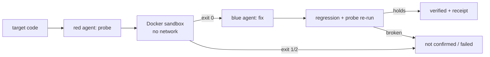

# Secure Mitigation System — how it works (technical companion to the README)

The README explains this project like you are five. This page explains it
like you build software: the loop, the parts, and where each part lives.

## The loop in one paragraph

A red-team Muse agent reads a code target and writes a small program (a
*probe*) that tries to cross an input boundary. The probe runs inside a
locked-down Docker container with no network: exit `0` means the boundary
was crossed, `1` means it held, `2` means the test itself was broken
(inconclusive). A blue-team Muse agent then writes a small fix (60 lines or
fewer), and trusted normal-input checks re-run on both the original and the
fixed code. Only when the probe flips from `0` to `1` and normal behavior is
unchanged is a cycle marked `verified`, with a machine-readable
`VerdictReceipt` (SHA-256 of the fix plus the exact Docker exits the claim
rests on). Every container is removed afterward.

Five bundled targets keep the loop reproducible: `node_query_sink` (Node
dynamic-expression sink), `node_chain_link` (chained two-link fixture),
`php_command_sink` (PHP local-command argument), `mysql_insecure_conf`
(MySQL config audit), and `binary_argv_echo` (compiled-ELF fixture for the
binary path).

## Where things live

- `library/core/` — the engine room: Muse transport, prompts, Docker
  sandbox, patch guards, fixture registry, pricing, profiles.
  (`docs/REFACTOR_PLAN.md` has the full per-file map.)
- `library/workflows/` — the five verification loops: fixture, 3-pass sweep
  (common, deep mutation, threat-actor), binary sweep, project workflow,
  CVE triage with reachability scoring.
- `library/intel/` — keyless threat intel (OSV, CIRCL, GitHub Advisory,
  EPSS, KEV): paced, size-capped, never raises, host-only. Intel grounds
  reasoning; Docker evidence alone decides verdicts.
- `library/services/` — product surfaces: MCP bridge, Python library API,
  repo intake, demo generation, project agents, chatter.
- `library/shared/` — code reused across areas: compression, vault helpers,
  async/HTTP/budget/record/redact/scan-parse/text utilities.
- `main.py` — one entry point: CLI flags, FastAPI + WebSocket server,
  MCP over STDIO and HTTP. `tui.py` + `sms_cli.py` — the terminal surface.
  `static/` + `scripts/mcp_client_demo.py` — dashboard and demo client.
- Category maps with file-level indexes: `web/` in `docs/web/INDEX.md`,
  `tui/` in `docs/tui/INDEX.md`, `mcp/` in `docs/mcp/INDEX.md`.

## Surfaces (all five stay in sync)

CLI (`main.py --scan --sweep-passes --binary-target --mcp ...`), TUI
(`tui.py`), Web UI (`static/` at `/`), MCP (`POST /mcp`, `--mcp` STDIO),
Python library (`from library.services.sms_api import scan_source`).

## Reference

- Commands and flags: `docs/reference/CLI.md` (+ `MODULES.md` module map,
  `DASHBOARD.md` panel map, `VAULT_PERF.md` vault numbers).
- Workflow guides: `docs/guides/`.
- Design decisions: `docs/decisions/` (ADRs). Past research waves:
  `docs/research/` + `docs/architecture/WAVE*.md`. Traps:
  `docs/TRAPS.md` (what looked right and was not).
- Historical session material (ledgers, journals, ship reports, per-run
  evidence): git-ignored `.jcode/session/` + `.jcode/briefs/`, kept for
  agents, not for readers. Canonical spec history: `docs/SPEC.md`.
