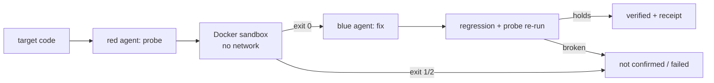

# Secure Mitigation System — how it works (technical companion to the README)

The README explains this project like you are five. This page explains it
like you build software: the loop, the parts, and where each part lives.

## The loop in one paragraph

A red-team Muse agent reads a code target and writes a small program (a
*probe*) that tries to cross an input boundary. The probe runs inside a
locked-down Docker container with no network: exit `0` means the boundary
was crossed, `1` means it held, `2` means the test itself was broken
(inconclusive). A blue-team Muse agent then writes a small fix (60 lines or
fewer), and trusted normal-input checks re-run on both the original and the
fixed code. Only when the probe flips from `0` to `1` and normal behavior is
unchanged is a cycle marked `verified`, with a machine-readable
`VerdictReceipt` (SHA-256 of the fix plus the exact Docker exits the claim
rests on). Every container is removed afterward.

Five bundled targets keep the loop reproducible: `node_query_sink` (Node
dynamic-expression sink), `node_chain_link` (chained two-link fixture),
`php_command_sink` (PHP local-command argument), `mysql_insecure_conf`
(MySQL config audit), and `binary_argv_echo` (compiled-ELF fixture for the
binary path).

## Live progress lines (additive, parser-safe)

Long scans emit progress on the same `(team, message)` stream the
dashboard, TUI, and CLI already render — no new channel, no new schema:

- Red source batches: `[phase red review] batch i/N` before each awaited
  model call (project workflow; `library/services/project_agents.py`
  `on_progress` hook).
- Blue proposal attempts: `[phase blue patch] attempt i/N` (project
  workflow; `1/1` on the single-attempt fixture loop).
- Sandbox verifies: `[phase verify] start (<stage>)` /
  `[phase verify] done (<stage>)` brackets around every isolated verifier
  run (fixture, sweep, binary sweep, project loops).
- Await-gap chatter: persona-voice lines (`library/services/chatter.py`)
  while model calls are in flight, rate-limited to one per 4 batches and
  at most 8 per run (`library/shared/sms_progress.py` `ChatterBudget`).

Parser contract: every new line reuses the exact `[phase ...]` tag shape
and carries no exit-code token, so `web/js/stream/rules.js` `stageOf()`
and the exit entity (`web/js/model/extract.js`) behave exactly as before —
only the pre-existing exit-code lines drive findings/patches counts
(pinned by `tests/test_slice_e_feedback_red.py`, including a live stream
through the real node-vm interpreter). Backpressure: `make_log`
(`library/shared/sms_async.py`) swallows emit errors AND bounds each emit
at `EMIT_TIMEOUT_S` (0.5 s), so a dead/slow socket degrades to dropped
frames — cleanup always runs. UI feeds stay capped (comms 120 / activity
1500 / timeline 900 / events 2000), so long runs cannot overflow the DOM.

## Where things live

- `library/core/` — the engine room: Muse transport, prompts, Docker
  sandbox, patch guards, fixture registry, pricing, profiles.
  (`docs/REFACTOR_PLAN.md` has the full per-file map.)
- `library/workflows/` — the five verification loops: fixture, 5-pass sweep
  (standard: common CVE patterns; deep: edge cases and input-mutation
  handling; threat-actor: logic abuse + technical exploitation; chain:
  multi-step logic-abuse chains that bare single loops miss; coverage:
  hardcoded secrets, vulnerable dependencies, weak crypto, missing authz,
  dangerous config),
  binary sweep, project workflow,
  CVE triage with reachability scoring.
- `library/intel/` — keyless threat intel (OSV, CIRCL, GitHub Advisory,
  EPSS, KEV): paced, size-capped, never raises, host-only. Intel grounds
  reasoning; Docker evidence alone decides verdicts.
- `library/services/` — product surfaces: MCP bridge, Python library API,
  repo intake, demo generation, project agents, chatter.
- `library/shared/` — code reused across areas: compression, vault helpers,
  async/HTTP/budget/record/redact/scan-parse/text utilities.
- `main.py` — one entry point: CLI flags, FastAPI + WebSocket server,
  MCP over STDIO and HTTP. `tui.py` + `sms_cli.py` — the terminal surface.
  `web/` + `scripts/mcp_client_demo.py` — dashboard and demo client.
- Category maps with file-level indexes: `web/` in `docs/web/INDEX.md`,
  `tui/` in `docs/tui/INDEX.md`, `mcp/` in `docs/mcp/INDEX.md`.

## Surfaces (all five stay in sync)

CLI (`main.py --scan --sweep-passes --binary-target --mcp ...`), TUI
(`tui.py`), Web UI (`web/` at `/web/`), MCP (`POST /mcp`, `--mcp` STDIO),
Python library (`from library.services.sms_api import scan_source`).

## Reference

- Commands and flags: `docs/reference/CLI.md` (+ `MODULES.md` module map,
  `DASHBOARD.md` panel map, `VAULT_PERF.md` vault numbers).
- Workflow guides: `docs/guides/`.
- Design decisions: `docs/decisions/` (ADRs). Past research waves:
  `docs/research/` + `docs/architecture/WAVE*.md`. Traps:
  `docs/TRAPS.md` (what looked right and was not).
- Historical session material (ledgers, journals, ship reports, per-run
  evidence): git-ignored `.jcode/session/` + `.jcode/briefs/`, kept for
  agents, not for readers. Canonical spec history: `docs/SPEC.md`.
